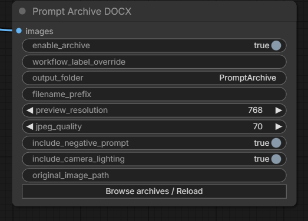
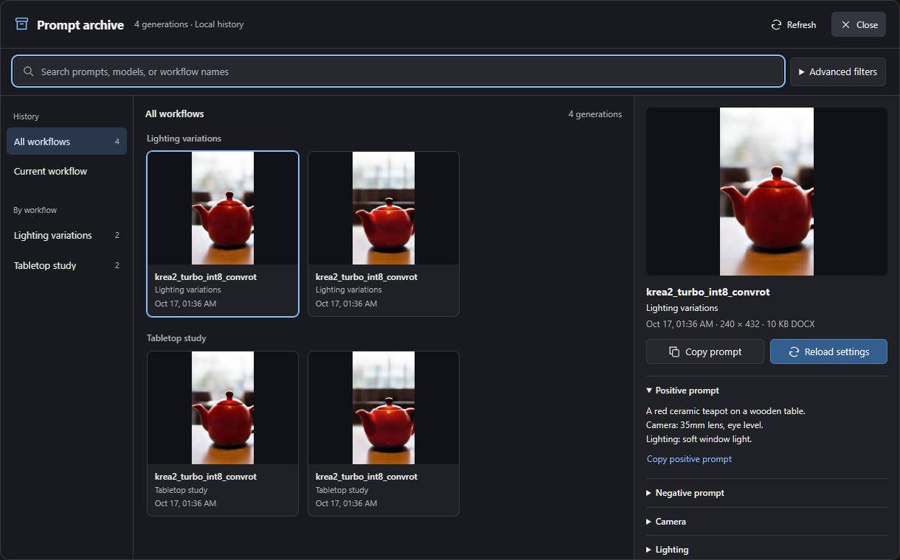
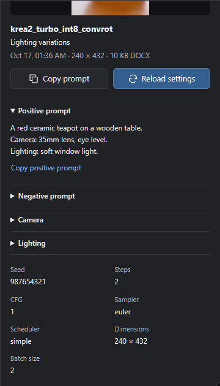
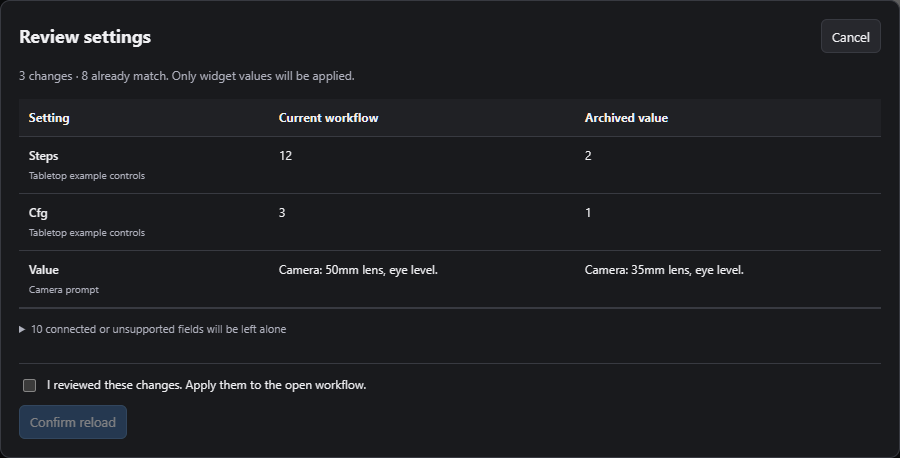

# ComfyUI Prompt Archive DOCX

Save an image preview, prompts and generation settings in a compact Word document, then browse the archive and restore mapped settings in the currently open ComfyUI workflow.

The package adds one output node, **Prompt Archive DOCX**, and a browser extension. Reload changes existing widgets after a comparison and confirmation. It does not load another workflow or create duplicate nodes.

## Features

- One DOCX per input image, with a compressed JPEG preview and readable generation details.
- A persistent SQLite index shared across workflows.
- An image gallery grouped by workflow, with search and optional model, LoRA, date and workflow-hash filters.
- A detail panel with captured prompts, model, LoRAs, sampler settings and file location.
- Copy prompt/path, download DOCX, and local Windows file/folder controls.
- In-place reload with a before/after comparison, explicit confirmation, and checks for changed graph structure or stale comparisons.

## Screenshots

These are captures of the real ComfyUI node and browser using isolated, sanitized copies of neutral verification records. They demonstrate the interface, not a new model-generation benchmark. Local filesystem paths are masked; no production archive database, private prompts or original image files are included in this repository.









## Requirements

- A working ComfyUI installation with its normal Python dependencies and browser frontend.
- The package imports NumPy, Pillow and aiohttp, which are already dependencies of ComfyUI. SQLite, ZIP and XML support come from Python's standard library. There are no additional package-specific dependencies and no need for `python-docx`.
- A DOCX reader is optional for opening documents outside ComfyUI.

Tested on Windows with ComfyUI **0.38.0**, frontend **1.53.10**, and Python **3.13**. Other versions and operating systems have not been verified. File/folder opening is implemented only for local Windows browsers; downloading is the fallback elsewhere. The archive node itself does not require a particular model or GPU.

## Installation

In the `custom_nodes` directory of your actual ComfyUI installation:

```sh
git clone https://github.com/dharaniVibeDev/comfyui-prompt-archive-docx.git
```

Check for an existing copy first, including a folder named `prompt-archive-docx`. Do not install two copies: they register the same node and HTTP routes. This repository needs no separate dependency installation in an environment that already satisfies ComfyUI's requirements.

Restart ComfyUI when it is safe to do so, then refresh its browser. Find **Prompt Archive DOCX** under **Prompt Archive** in the node menu. Back up the archive database and documents before updating an existing installation; replacing a package folder must not replace its stored data.

## Usage

1. Add **Prompt Archive DOCX** to your workflow and connect the final decoded `IMAGE` to `images`.
2. Leave archiving enabled. Optionally set a workflow label, filename prefix or preview options.
3. Queue the workflow normally. Each image in the batch produces its own record and DOCX. This node does not save an additional full-resolution image.
4. Click **Browse archives / Reload** on the node. Choose **All workflows**, **Current workflow**, or a named workflow. Search or expand **Advanced filters** as needed.
5. Select an image to inspect its stored prompts, settings and document location.
6. To restore values, click **Reload settings**, review the comparison, select the confirmation checkbox and click **Confirm reload**. Queue separately when ready.

Canceling a comparison leaves the graph alone. Reload neither starts a generation nor saves the workflow file to disk; saving the edited workflow remains a normal ComfyUI action.

## How archive storage works

By default, documents are written beneath ComfyUI's configured output directory:

```text
output/PromptArchive/
  archive.sqlite3
  <workflow label>/
    <YYYY-MM-DD>/
      <prefix>_<time>_<record-id>.docx
```

The global index remains at `PromptArchive/archive.sqlite3` even when a node uses a different document subfolder. Each database row includes searchable workflow/model fields and a JSON record containing captured settings, prompt sources, notes, graph topology and the frontend widget snapshot. This is not a full saved workflow JSON.

The DOCX contains one JPEG preview and text. Defaults are a **768px longest edge** and **JPEG quality 70**; smaller images are not upscaled. No original PNG or workflow JSON is embedded. Gallery thumbnails are made in memory from the DOCX preview, capped at 256px and browser-cached. They are not stored as large blobs in SQLite or saved as extra full-resolution images.

Back up both the database and document folders. A standalone DOCX is readable without the database, but the current reload feature reads SQLite rather than reconstructing records from DOCX files. Moving documents manually leaves their indexed paths stale.

## How generation settings are preserved

The node receives ComfyUI's hidden execution `PROMPT` and `EXTRA_PNGINFO` inputs. The frontend adds the active workflow name/path when available and a snapshot of supported widgets, including widgets inside native subgraphs. Capture follows the archive node's upstream execution inputs; it does not rewrite prompt strings.

Records can contain positive, negative, camera and lighting text; checkpoint or diffusion-model name; LoRA names and strengths; base seed; steps; CFG/guidance; sampler; scheduler; dimensions; batch size/index; archive timestamp; workflow label/hash; document path; and capture notes. The actual image tensor determines the recorded output dimensions and batch size.

Supported primitive values, built-in text concatenation and statically resolvable switches can be traced. Multiple text sources are labeled separately. Ambiguous aggregate settings remain unavailable, with per-node data retained. Camera/lighting extraction depends on separately titled upstream text nodes. `ConditioningZeroOut` is recorded as empty conditioning, not an invented negative prompt.

An `IMAGE` tensor has no original filename. Supply `original_image_path` only when you know an existing path. The timestamp is the time of archiving, which may differ from the time an upstream cached image was originally generated.

## How workflow settings are restored

1. The browser checks a structural hash based on node IDs/types and named connections. It ignores layout, changing widget values and the archive node itself.
2. Stored values are matched to the existing node path, type and widget name. Native subgraphs are traversed, including promoted outer controls.
3. The comparison lists values that would change. Seed behavior is included: mapped seed controls are set to fixed for replay.
4. After confirmation, the browser checks that the graph, node objects and reviewed values have not changed, then assigns mapped widget values through their setters.

If another node was added, removed or rewired, the structural hash normally differs and reload is blocked. Use the matching workflow rather than expecting the archive to reconstruct it. Missing widgets, connected inputs, unavailable model choices and invalid values are reported or skipped. Connected widgets are supplied by their mapped source/promoted controls instead of overwriting connections. Arbitrary widget callbacks are not invoked.

Reload operates on the current graph. It does not import a workflow JSON, add nodes, replace the workflow or rewire it. Applying values marks the graph as changed for the normal ComfyUI editing flow.

## Supported and unsupported nodes/settings

| Area | Implemented mapping and limits |
| --- | --- |
| Models | `ckpt_name` and `unet_name`, plus selected CLIP/VAE and weight fields. A real diffusion-model workflow was tested; a checkpoint-loader generation was not. Model files are never installed or renamed by reload. |
| LoRAs | Common loader name/model/CLIP strengths, numbered promoted controls and supported dynamic LoRA values. Opaque custom widget internals are not guaranteed. |
| Sampling | Common seed/noise-seed, steps, CFG/guidance, sampler-name, scheduler, denoise and step-range widgets. Real runs used KSampler. Custom samplers are supported only where they expose mapped widgets; there is no universal adapter. |
| Prompts | Common text encoders, primitive text widgets and supported source controls. Final text produced by an opaque runtime LLM/custom transform cannot be recovered if it was never captured. |
| Dimensions | Common width, height, batch, aspect-ratio, resolution and megapixel widgets. Computed output dimensions are recorded but cannot always be assigned directly. |
| Graphs | Matching node IDs/types and connections; native subgraphs/promoted controls were tested. Different workflows are not matched heuristically. |

See [`web/widgets.js`](web/widgets.js) for the widget-name allowlist and [`web/reload.js`](web/reload.js) for validation and apply behavior. Unsupported raw inputs remain in the record and are explained in the comparison/report.

## Archive location and configuration

`output_folder` is relative to ComfyUI's configured output root; absolute paths must also remain inside that root. Workflow labels and prefixes are sanitized for filenames. Changing a label changes grouping/folders for future records; identical graph structures can share a hash and still have different labels.

The node controls archiving, label, subfolder, prefix, preview resolution/quality and document sections. Excluding negative or camera/lighting sections affects the DOCX; the database still retains captured values for reload. There is no background service or scheduled task.

## Troubleshooting

- **Node is missing:** check the startup log, correct `custom_nodes` folder, duplicate installations and ComfyUI's Python dependencies; restart only when no work will be interrupted.
- **Gallery does not load after an update:** restart ComfyUI to register its routes and hard-refresh the browser to load the matching frontend files.
- **Workflow structure does not match:** reopen the matching workflow and keep an archive node present. Do not remove the hash check or force settings onto another graph.
- **Preview or document is missing:** inspect the saved path; the database does not track manual moves. Settings can remain readable even when the preview is unavailable.
- **Open DOCX fails:** configure a Windows DOCX reader or download the file. Opening a file/folder is limited to local Windows requests; remote browsers should download or copy the path. Windows may normalize clipboard line endings.
- **Prompt is unavailable:** the final output of a runtime text-generating node may not have been stored. The inspector can show captured source text without presenting it as the missing final prompt.

## Install with a coding agent

Copy the following prompt into Codex CLI, Claude Code, Cursor, or another coding agent with filesystem and terminal access:

```text
Install https://github.com/dharaniVibeDev/comfyui-prompt-archive-docx.git
into my actual ComfyUI installation.

First locate ComfyUI and identify the exact Python interpreter/environment
used to run it. Inspect this repository's README and source installation
requirements before making changes. Do not assume a default folder or use
an unrelated system Python.

Inspect the installation's custom_nodes directory for this repository and
any existing package registering PromptArchiveDOCX, including a folder
named prompt-archive-docx. Avoid duplicate installations. If a copy already
exists, explain what you found and ask before updating, moving, replacing,
or otherwise modifying it. Never overwrite local changes or user data.

For a new installation, clone the repository into that ComfyUI instance's
custom_nodes directory as comfyui-prompt-archive-docx. Install only missing
required dependencies, and only through ComfyUI's own Python interpreter.
The package uses ComfyUI's existing NumPy, Pillow and aiohttp dependencies;
do not install python-docx or invent additional requirements.

Preserve all ComfyUI settings, other custom nodes, models, LoRAs, workflows,
prompts, images, DOCX archives and SQLite databases. Never overwrite,
delete, replace or reset an archive database. Never copy an example
database over an existing one. Do not unnecessarily upgrade ComfyUI,
Python, PyTorch, CUDA or drivers. Do not alter existing workflows to insert
the node automatically.

Verify Python syntax, required imports, backend node registration and the
included frontend assets. Run the repository tests using ComfyUI's Python
where practical, without executing private workflows or changing archive
data. Report exactly which checks passed and which could not be run.

Ask for my permission before restarting ComfyUI, and do not interrupt an
active generation. Explain how to refresh the browser, find Prompt Archive
DOCX under Prompt Archive, connect an IMAGE, save an archive, browse its
history, and review/confirm Reload settings in the same matching workflow.
Report the installation path, Python interpreter, default archive location,
verification results and any problems or unsupported mappings.
```

## Limitations

- SQLite and DOCX files contain prompts, settings and local paths in plaintext. Treat them as private data; do not commit them or expose a ComfyUI server to untrusted users. The library uses ComfyUI's own server/access model, not a separate account system.
- Reload requires the database and matching graph structure. It is not a portable workflow backup or a DOCX-import feature.
- Arbitrary custom widgets, runtime-selected branches and final text generated by opaque nodes are not universally supported. Image previews and recorded values do not guarantee identical image reproduction across model/software changes.
- Stored seeds describe the executed batch's base seed; records retain a batch index without inventing an independent per-image seed. Reload restores the batch settings, not a cropped member of the batch.
- This release does not claim universal ComfyUI/frontend compatibility or Linux/macOS desktop integration.

For reproducible checks and the verified environment, see [Testing](docs/TESTING.md).

## License

MIT. See [LICENSE](LICENSE).
